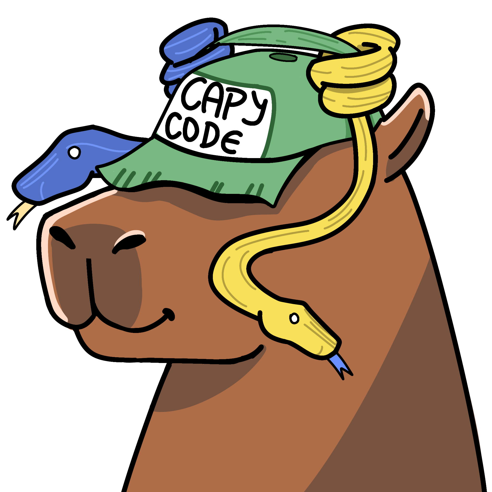
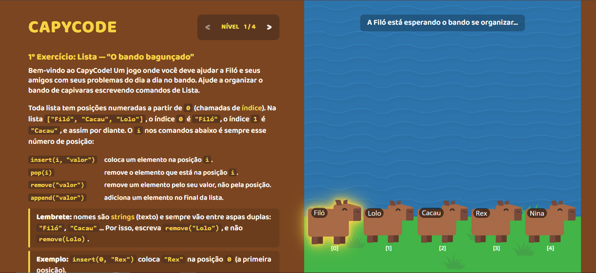

#  CapyCode



Jogo didático para aprender lógica de programação com **listas** e **pilhas**. Você escreve comandos no editor e vê o bando de capivaras se reorganizar na hora.

**Jogar online:** https://claradevneve.github.io/CapyCode/html/CAPYCODE.html

Inspirado no [Flexbox Froggy](https://flexboxfroggy.com/), de Thomas Park — [repositório original](https://github.com/thomaspark/flexboxfroggy).

## Autores

- [Maria Clara](https://github.com/ClaraDevNeve)
- [Jordan Cunha](https://github.com/JORD4N-01)
- [Lucas Albuquerque](https://github.com/yLucasVale)

## Níveis

| Nível | Arquivo | Tema | Comandos |
| --- | --- | --- | --- |
| 1 — O bando bagunçado | `html/CAPYCODE.html` | Listas | `insert()`, `pop()`, `remove()`, `append()` |
| 2 — A uva escondida | `html/exercicio2.html` | Pilhas | `append()` + `pop()` entre `cacau`, `cuia` e `Filó` |

Os níveis 3 e 4 estão previstos em `js/componentes.js` (na tabela `PAGINAS`) e ainda não têm arquivo.

## Como rodar

A versão publicada está em https://claradevneve.github.io/CapyCode/html/CAPYCODE.html — é só abrir no navegador.

Para rodar localmente, o projeto é estático: sem build, sem dependências e sem servidor obrigatório. Basta abrir `html/CAPYCODE.html` no navegador.

Se preferir servir via HTTP, na raiz do repositório:

```sh
python -m http.server 8000
```

E acesse `http://localhost:8000/html/CAPYCODE.html`.

## Como jogar

Cada nível traz um enunciado curto, exemplos e um `<textarea>`. Escreva **um comando por linha**: a cena e o `print(...)` são atualizados enquanto você digita. Quando o objetivo for alcançado, clique em **Próximo** para avançar. A seta no cabeçalho também volta ao nível anterior.

## Estrutura

```text
html/   páginas dos níveis
css/    estilos compartilhados
js/     componentes.js (cabeçalho/rodapé e navegação), exercicio1.js e exercicio2.js
img/    sprites das frutas/capivaras e fundos das cenas
```

## Licença

[MIT](LICENSE) — Copyright (c) 2026 Maria Clara Neves.
